# Onboard Skill 执行 reset

`reset` 与 `init` 共用 Python 管线：plan → 所选项目只读状态／目标前置检查 → stable required external 安装 → 受管模板写入 → SBTD 复查。它不迁移或清理项目数据，也不卸载全局工具。

相对 `init` 的语义差：

- 用户明确要求重装／重置所选已有配置；版本对齐优先走有计划、备份与恢复证据的 `upgrade`，不是把 reset 当作升级器。
- React Bits：检测到既有 Free / Starter / Pro / Ultimate 时必须保留，不得默认改成免费版。
- 保留 containment、canonical 身份、事务 rollback 和用户确认；不调用 Trellis，不重建旧状态。

目标 Agent 平台仍是单数。Q4 项目 `AGENTS.md` 仍须单独确认。

执行前核对已审阅的 v2 包和真实目标，特别确认 bundled Skills 的无备份覆盖风险；需要保留定制内容时先另行授权备份或选择 upgrade。可复制的 reset 提示词见[中文 README](../../README.zh.md#onboard-prompts)和[英文 README](../../README.md#onboard-prompts)；v1 数据迁移不由 reset 执行。

```mermaid
flowchart TD
  start[Agent 调用 sbtd-workflow-onboard 执行 reset] --> q[解析 Required Questions]
  q --> plat{目标 Agent 平台是否已给出且为单数?}
  plat -->|否或给了多个| askPlat[停下来问唯一平台]
  plat -->|是| q4{用户是否明确同意重写项目 AGENTS.md?}
  q4 -->|未表态| askAgents[停下来问 Q4]
  q4 -->|明确跳过| skipProjAgents[带 --skip-project-agents]
  q4 -->|明确安装或重置| wantProjAgents[计划备份后覆盖项目 AGENTS.md]
  askPlat --> stopAsk[等待用户]
  askAgents --> stopAsk
  skipProjAgents --> earlyCheck
  wantProjAgents --> earlyCheck[完整只读 check-projects, 尊重 AGENTS 选择]
  earlyCheck --> earlySafe{所有所选项目允许安装?}
  earlySafe -->|否| earlyBlock[报告冲突, 不执行全局或项目安装写入]
  earlySafe -->|是| cliGate
  cliGate["check-agent-cli --platform 唯一平台"] --> cliOk{该平台 version 命令通过?}
  cliOk -->|是| skipCli[already-installed: 不重装]
  cliOk -->|否| repairCli[只修复缺失或校验失败的 CLI]
  skipCli --> preflight
  repairCli --> preflight[check 全局 runtime / tools / Skills]
  preflight --> graftProbe[install-graft --json 只读探测]
  graftProbe -->|already-installed| preserve
  graftProbe -->|blocked / 其他失败| skipGraft[说明原因, 不覆盖冲突内容, 继续不依赖 Graft 的步骤]
  graftProbe -->|needs-confirmation| graftConsent{展示安装或仅 telemetry 计划后明确同意?}
  graftConsent -->|否| skipGraft
  skipGraft --> preserve
  graftConsent -->|是| installGraft[Python install-graft --yes]
  installGraft --> graftReady{包/native/telemetry 验证通过?}
  graftReady -->|否| blockTools[失败如实报告, 不循环安装]
  graftReady -->|是| preserve{React Bits 已检测到 tier?}
  preserve -->|是| keepTier[保留已检测 tier 和 registry]
  preserve -->|否或不适用| noRb[不询问也不安装 React Bits]
  keepTier --> plan
  noRb --> plan[输出 plan --json]
  plan --> confirm{确认执行 reset --yes?}
  confirm -->|否| abort[不写文件]
  confirm -->|是| stateCheck[检查所有所选项目状态及安装目标]
  stateCheck --> stateOk{允许写入?}
  stateOk -->|否| stateBlock[逐项目报告, Python 零安装写入]
  stateOk -->|是| provider{官方 Ponytail plugin 已启用?}
  provider -->|是| providerBlock["阻断: provider=conflict, 人工禁用或移除 plugin 后重跑"]
  provider -->|否或无法检测| identity{legacy Skill 身份冲突?}
  identity -->|是| failClosed[fail-closed: 原目录不动]
  identity -->|否| installExt[从 stable 强制覆盖全部 19 个 required external Skills]
  installExt --> migrate[只迁身份匹配的 legacy 目录]

  migrate --> writes[同一套 operations 回写]
  writes --> gAgents{全局 AGENTS 目标已存在?}
  gAgents -->|从未写过| copyGlobal[复制到解析后的 Codex 全局 AGENTS 路径]
  gAgents -->|已存在| bakGlobal[备份后覆盖当前模板]
  copyGlobal --> bundled[bundled Skills]
  bakGlobal --> bundled
  bundled --> bExist{bundled Skill 目录已存在?}
  bExist -->|从未安装| copyBundled[复制]
  bExist -->|已安装| owBundled[无备份整目录覆盖为当前模板]
  copyBundled --> gitignore[项目 gitignore]
  owBundled --> gitignore
  gitignore --> gi{项目 gitignore 行齐全?}
  gi -->|否| appendGi[只追加缺行]
  gi -->|是| skipGi[skipped-already-present]
  appendGi --> pAgents
  skipGi --> pAgents{本轮是否重写项目 AGENTS.md?}
  pAgents -->|否| done
  pAgents -->|是且不存在| copyProj[复制模板]
  pAgents -->|是且已存在| bakProj[备份后覆盖]
  copyProj --> done[只读复查 SBTD, 汇总覆盖项 / 跳过项 / 备份]
  bakProj --> done
```

## 从未安装 vs 已安装后再 reset

| 对象 | 环境从未装过就直接 reset | 已装过再 reset |
|---|---|---|
| 行为本质 | 与 `init` 相同的补齐 + 写入 | 检查后把模板回写到已有目标 |
| Agent CLI / npm / Graft | 缺失 Agent 按既有授权修复；Graft另行展示计划并确认 | 已验证则不重装，不自动升级 |
| 19 个 required external Skills | 从 stable 事务安装；官方 Ponytail plugin 启用时阻断 | **强制覆盖** 为当前 stable 快照 |
| bundled Skills | 复制 | **无备份覆盖** 为当前 Onboard 模板 |
| 全局 `AGENTS.md` | 复制 Codex 目标；若 `~/.omp` 已存在则另写 `~/.omp/agent/AGENTS.md` | **备份后覆盖**；不创建缺失的 `~/.omp` |
| 项目 `AGENTS.md` | 仅 Q4 同意时复制 | 同意则备份后覆盖 |
| `.gitignore` | 追加缺行 | 行齐全则 skip |
| task / identity / spec / lessons / handoff / 旧 `.trellis` | 不预建 | **不删除、不重建、不迁移**；异常或旧状态先报告 |
| React Bits | 不适用则不问 | **保留已检测 tier** |
| 全局工具卸载 | 不做 | 不做 |

若目标是「只改项目、不动全局」，应改用 `init-projects`，不要用 `reset`。
