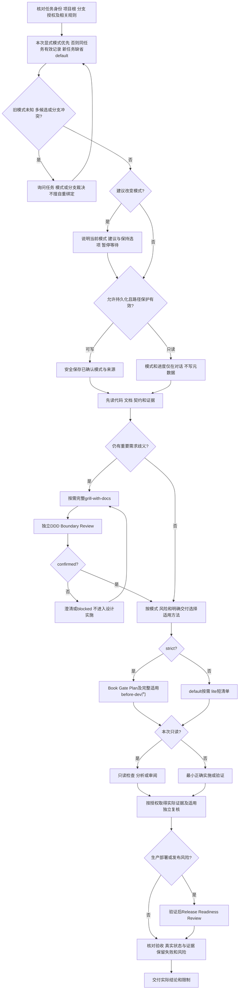

# SBTD v2 支持的工作路径

现行主线是 Codex / OMP + `sbtd-task` + 按需 Graft。本文描述用户任务的路由，不是新调度器；具体模式、状态及方法合同以[任务 Skill](../../sbtd-workflow-onboard/templates/skills/sbtd-task/SKILL.md)为准。安装与升级示例见[中文 README](../../README.zh.md#onboard-prompts)和[英文 README](../../README.md#onboard-prompts)。

## 先路由，再选择方法

- 完整 grill 后的独立 DDD 门适用于所有模式；需求已清楚时说明未完整调用的原因，不制造重复询问。
- 升级和降级模式均先建议、暂停、等待用户选择。拒绝后保持原模式，同风险不反复询问；新实质风险才重新评估。
- `default` 按需工作；`lite` 保留目标、范围、验收、实施、验证及交付短清单；`strict` 执行全部适用门。用户明确产物和项目安全规则不随模式降级。
- 纯只读不创建 task/active/handoff/developer/ignore，也不运行有未核实缓存或接线副作用的查询。普通任务不因未初始化完整工作流而自动运行 Onboard。

## 按目标选择能力

| 目标 | 入口与适用条件 | 边界 |
|---|---|---|
| 安装、升级、项目初始化 | `sbtd-workflow-onboard`；先确认精确源版本、目标及只读计划 | init保留合法壳，reset可无备份覆盖bundled；版本对齐用upgrade，旧数据用migration，各阶段独立授权 |
| 需求、规格与工单 | 按需 `grill-with-docs` / `grilling`、`domain-modeling`，明确交付时用 `to-spec` / `to-tickets` | 不把普通问答变成完整访谈；工单发布另行确认 |
| 原因不明的故障 | `diagnosing-bugs`，从实际失败建立反馈回路 | 先区分产品、测试、环境和契约；不凭猜测修改 |
| 结构定位 | 按需 Graft 的已验证结构能力；不可用时使用实际源码/LSP/契约 | 只在授权单仓根，DNT且禁LLM/cloud；不对父目录联邦查询，不因空图/exit0认定无影响 |
| 持久数据、迁移和恢复 | `book-ddia-data-design`；strict命中时before-dev | 原件、所有权、回执、漂移和恢复边界有真实证明；不把文件恢复当旧运行时恢复 |
| 既有行为与重构 | 按触发使用 `book-legacy-change-safety`、`book-refactoring-pass` | 先保留行为证据；safety-seam-only不是行为修改豁免 |
| 用户可见行为 | `gherkin-bdd`及项目现有规范/测试 | 缺契约不编造；本配置源仓不生成.feature，真实业务项目按自己的规范 |
| 测试先行与可测试接口 | `tdd`、`codebase-design` | 对真实消费边界做有意义的红绿证明，不写源码措辞或mock回声测试 |
| 简洁实现与复核 | `ponytail`；非平凡生产diff按需 `ponytail-review` | 保留真实seam与可读性，不为短代码删除安全边界；audit/debt只在对应请求触发 |
| UI与组件 | `ui-ux-pro-max`；匹配项目时用 `shadcn`、`impeccable` | 尊重现有设计系统；React Bits须技术栈、需求、授权及许可证条件成立 |
| Web运行诊断 | Chrome DevTools MCP / Playwright MCP | 只作为诊断、探索或定位证据，不替代原生回归 |
| 可重复Web回归 | 项目Playwright CLI；需要可维护资产时用 `web-ui-autotest-generator` | 确认真实环境、账号、contract及报告位置；不以mock冒充full-stack |
| Mobile / Hybrid | `maestro-mobile-e2e`与项目Maestro CLI | Java/设备/app/backend等前置真实可用；MCP可选，不替代runner |
| 知识库摄取 | 用户需要时用 `knowledge-base-integration`及行为目录 | 只读请求保持Mutation:none，产品/Revision Set与证据策略来自实际配置 |
| 搜索可见性 | `seo-geo` | 仅公开站点/对应任务触发；无URL不假称线上审计 |
| 最终验证 | `project-validation`，生产/部署/发布风险再用 `book-release-readiness` | 使用项目原生命令、raw与同stem中文汇总；required失败不改为风险接受 |
| 长期经验 | 确有复用价值时用 `lessons-record` | 按当前身份规则核验，仅写本人marker；本仓入口docs/lessons.md，正文在topics/archive |
| 交接与恢复 | `sbtd-task`状态/交接reference | 真实暂停或切会话才写；有效task是事实源，旧handoff不覆盖模式，无普遍自动恢复承诺 |

## 执行与权限边界

- 当前宿主的原生执行能力负责工作；目录中出现某平台资产不自动选择宿主或启动第二套调度器。一个职责一个writer、一个验证环境一个controller。
- Trellis/GitNexus旧数据仅作为明确迁移或清理输入；不运行旧任务调度、旧Channel或Trellis初始化来启动v2任务。Graft安装和接线不由普通分析请求授权。
- 方法/工具不可用须区分required blocked与无关可选能力的安全fallback，不安装邻近工具伪造通过。完整grill后的DDD和strict必需门不得绕过。
- task、active、index和handoff职责不同：task拥有mode/status，active仅引用，index导航，handoff快照。跨分支需要明确裁决，不自动stash、checkout或rebind。
- 发布、workflow sync、真实迁移/部署、旧资产清理和备份销毁是不同权限。任务done不授权下一阶段；公开报告还需脱敏及明确发布位置。
